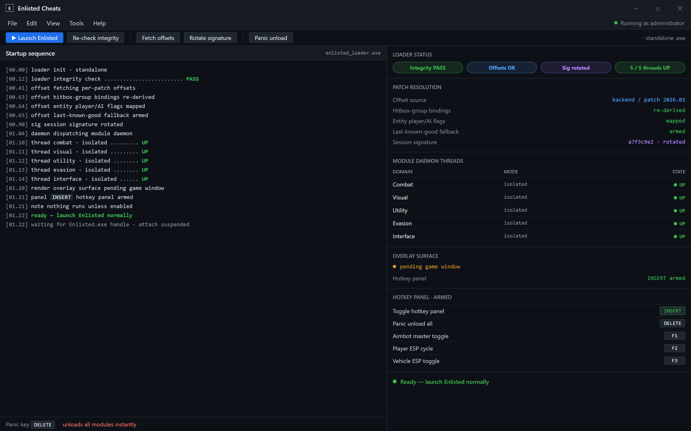
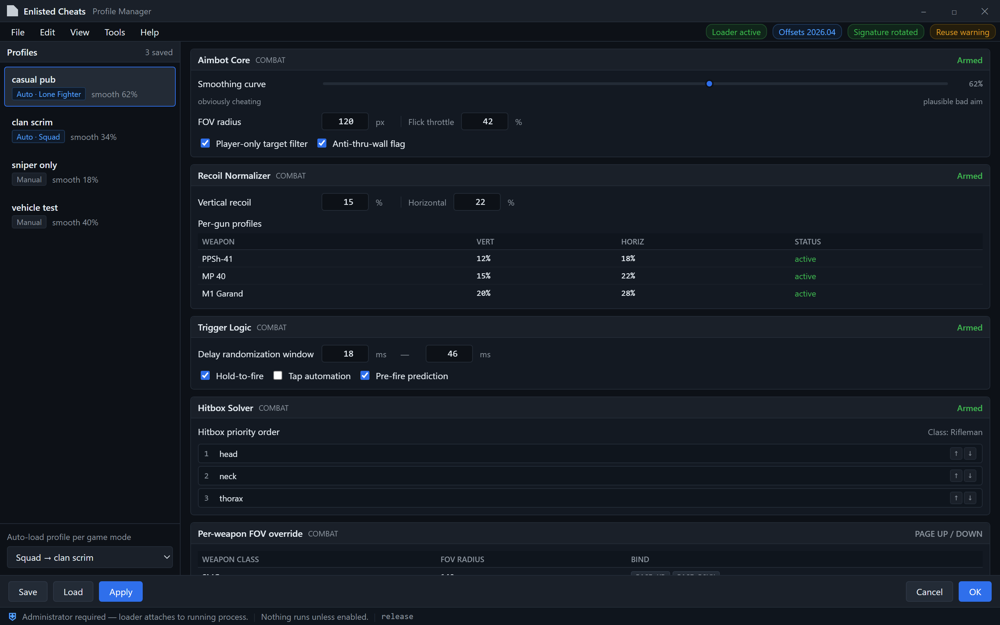

Loader verifies integrity, pulls per-patch offsets, rotates the session signature, then dispatches the module daemon into five isolated threads.

  
  
  

  

  
  

---

**The Enlisted Cheats project — rebuilt from scratch in 2026 with improved detection resistance, a proper module loader, and an actual maintenance schedule.**

---

## 🧭 Overview

| Category | Details |
|---|---|
| Project name | Enlisted Cheats |
| Purpose | External client-side cheat suite for Enlisted (Gaijin's squad-based WWII shooter) |
| Distribution | Standalone Windows build, no installer dependencies |
| Architecture | Background module daemon + hotkey-driven UI overlay |
| Status | Maintained, 2026 build cycle active |
| Audience | Enlisted players who already know why they're here |

If you've been around the Enlisted modding scene for more than a season, you already know the drill: half the releases die after two patches, the ESP boxes are misaligned against the tank hitbox solver, and the aimbot snaps onto the squad AI instead of the actual player because the entity list got fetched at the wrong offset. The 2026 rebuild of Enlisted Cheats addresses all three of those specifically — the offsets are re-derived per game patch, the box renderer reads from the synchronized entity transform rather than the visual mesh, and target filtering now distinguishes player-controlled vs AI-driven entities before it ever touches the aim vector.

This is not a new project cosplaying as an old one. It's the same niche concept, thrown out and rebuilt because maintaining a decade-old codebase against Gaijin's patching cadence was more work than starting fresh.

---

## 📦 Grouped module catalog

Nineteen modules across five domains. Everything is toggleable from the hotkey panel; nothing runs unless you enable it. The loader keeps each domain in its own isolated thread so a crash in one group can't take down the others.

### 🎯 Combat modules

**Module** — Aimbot Core
- Player-only target filter (ignores squad AI, AT gunners, radiomen bots)
- Smoothing curve adjustable from "obviously cheating" to "plausible bad aim"
- Per-weapon FOV override so SMG snap doesn't bleed into your sniper settings
- Flick-throttle to cap snap velocity and dodge heuristic detection

**Module** — Hitbox Solver
- Reads engine-scoped hitbox groups rather than mesh bounding boxes
- Head/neck/thorax priority in that order, rotatable per class
- Compensation for the 2025+ stance-blend animation system
- Anti-thru-wall flag so you don't fire through geometry you can't see

**Module** — Recoil Normalizer
- Vertical + horizontal recoil separately nulled or reduced to a percentage
- Per-gun profiles for the PPSh, MP 40, Garand, and the usual suspects
- Doesn't touch burst patterns — only resets drift between bursts

**Module** — Trigger Logic
- Hold-to-fire vs tap automation toggle
- Pre-fire prediction against sprinting player velocity
- Delay randomization in a user-set ms window

### 👁️ Visual modules — ESP family

**Module** — Player ESP
- Box, skeleton, name, and distance tier — each independently toggleable
- Team filtering (enemy / squad / both)
- Occlusion color (visible vs behind cover) so you stop prefiring into walls

**Module** — Vehicle ESP
- Tank and halftrack outlines with crew-count estimate
- Ammo-rack and engine-deck highlight zones
- Distance and heading readout

**Module** — Loot & Objective ESP
- Capture-point markers with current owner state
- Ammo box, medkit, and engineer-tool pickup highlights
- Rally-point and spawn-beacon listeners

**Module** — Sniper Glint Suppressor
- Removes the scope glint decal from opposing snipers when enabled
- Optional: leave own glint so you don't out yourself visually

### 🛠️ Utility modules

**Module** — No Sway / Hold Breath Bypass
- Removes scope sway without triggering the stamina drain
- Works alongside the bolt-action timing window

**Module** — Instant Weapon Swap
- Trims the swap animation to the draw-commit frame
- Toggleable per-slot so you can keep rifle grenade swaps honest if you want

**Module** — Stamina & Sprint Loop
- Sprint-loop without the breathing penalty at the tail
- Configurable delay before auto-resume

**Module** — Vehicle Proxy Aimbot
- Separate targeting solution for tank gunner and coaxial MG
- Lead compensation for the shell drop model

### 🛡️ Evasion & protection

**Module** — Anti-Spectate Guard
- Warns when a player-controlled spectator locks onto your entity
- Optional auto-suspend of the combat modules while observed

**Module** — Screenshot & Replay Cloak
- Suppresses overlay rendering during the game's native capture
- Hides ESP layers in the replay timeline so clips stay clean

**Module** — Offset Loader
- Fetches per-patch offsets on startup rather than hardcoding them
- Falls back to last-known-good set if the fetch fails
- Manual override field for when you're on a test branch

**Module** — Signature Scrambler
- Rotates the outbound module signature every session
- Warns if the same signature is reused twice in a row

### 🎛️ Interface & config

**Module** — Hotkey Panel
- In-game overlay for toggling everything above without alt-tabbing
- Drag-to-reposition, per-profile keybinds

**Module** — Profile Manager
- Save/load named profiles (one for "casual pub", one for "clan scrim")
- Auto-load a profile per game mode if you set it up

Named profiles per mode, per-weapon FOV, and a manual offset override for when you're on a test branch.

---

## ⌨️ Hotkeys / Controls

| Key | Action | Notes |
|---|---|---|
| `INSERT` | Toggle hotkey panel overlay | Global, works on menus and in-raid |
| `DELETE` | Unload all modules and drop overlay | Panic key; leaves loader running |
| `F1` | Aimbot master toggle | Independent of per-weapon settings |
| `F2` | Player ESP cycle | Off → boxes → skeleton → full |
| `F3` | Vehicle ESP toggle | Only affects vehicle outlines |
| `F4` | Loot & objective markers | Off by default, useful for defenders |
| `F5` | Sniper glint suppressor | Rapid toggle mid-scope |
| `F6` | No-sway toggle | Also releases the stamina hook |
| `F7` | Profile quick-swap | Opens the profile picker |
| `F8` | Anti-spectate guard | Turn off if a clanmate asks |
| `PAGE UP` | Increase FOV radius | Per-weapon, affects next snap |
| `PAGE DOWN` | Decrease FOV radius | Same |

---

## 📖 What is Enlisted Cheats

| Term | Explanation |
|---|---|
| Loader | The launcher `.exe` that runs first; it verifies integrity and dispatches the module daemon |
| Offset loader | Runtime routine that resolves per-patch memory offsets instead of shipping hardcoded ones |
| Entity filter | The stage that classifies tracked entities as player, AI, vehicle, or pickup before any cheat engine acts on them |
| Hitbox group | The engine's own per-bone grouping used for damage calculation — we read these, not visual meshes |
| Overlay | The transparent in-game draw layer used for ESP and the hotkey panel |
| Signature | The per-session fingerprint the load dispatcher emits to backend-dependent modules (offset fetch, cloak) |
| Panic key | `DELETE` — nukes all active modules in one keystroke without closing the game |

Benefits of this approach over the older generation of Enlisted releases:

- Module isolation means an ESP crash won't eat your aimbot mid-fight
- Per-patch offset refresh is automated, not chased manually on forums
- Recognition filter actually distinguishes player from AI, which the old builds got wrong constantly
- Panic key is instantaneous and doesn't rely on the overlay processing the event
- Profiles separate your casual and scrim configurations instead of rebuilding keybinds each session

---

## 🧨 The Problem

- Gaijin's 2024 patch changed the hitbox group binding order, and every public release took weeks to catch up — most users just got banned instead.
- Squad AI in the "Lone Fighter" mode spawns with the same entity flags as low-rank players, so naive aimbots snap to bots and set off the anti-cheat heuristic looking for impossible aim velocity against non-player entities.
- The in-game screenshot tool fires even when replays are off, quietly capturing your overlay in every match.
- Recoil behavior changed with the 2025 weapon rework and every profile-based release shipped with stale tables.
- Vehicle combat needs a completely different targeting solution than infantry, but almost all releases bolt tank aim onto the infantry approach — shells drop, tanks don't snap.
- Most "undetected" releases are undetected until somebody clones the binary, then the whole userbase gets batched.

---

## 🧩 The Solution

| Problem | Solution |
|---|---|
| Hitbox group reordering across patches | Offset loader re-derives groups per-patch; no release lag |
| Squad AI vs player misidentification | Entity recognition stage filters on player-controlled flag before aiming |
| Screenshot tools capturing overlay | Screenshot cloak hooks the capture path and blanks the overlay |
| Stale recoil tables after weapon rework | Recoil profiles loaded from signed backend, refreshed on loader start |
| Vehicle vs infantry targeting mismatch | Separate vehicle proxy module with lead/drop compensation |
| Signature cloning ban waves | Per-session signature rotation in the Signature Scrambler |

---

## 🧮 Key Features

| Feature | Description | Benefit |
|---|---|---|
| Per-patch offset fetch | Loader resolves offsets at startup instead of trusting the binary | No waiting for releases after a Gaijin patch |
| Player/AI entity filter | Classifies entities before cheat logic runs | Stops bots from triggering heuristics |
| Module thread isolation | Each domain runs in its own thread | One crash doesn't cascade |
| Panic key | `DELETE` unloads everything instantly | Escape hatch without game restart |
| Profile system | Named configs, auto-load per mode | No reconfiguring across modes |
| Screenshot cloak | Hooks native capture | Clean clips, no ESP in replays |
| Anti-spectate guard | Warns on spectator lock | You know when you're being watched |
| Vehicle proxy targeting | Separate ballistics model for tanks | Actually usable in armored mode |
| Sniper glint suppression | Removes enemy scope glint | True to the niche |
| Signature rotation | Per-session fingerprint | Reduces clone-based ban risk |

---

## 🧲 Requirements bake-in

| Component | Minimum | Recommended |
|---|---|---|
| OS | Windows 10 (21H2 or newer) | Windows 11 23H2+ |
| Game | Enlisted retail (Steam or Gaijin launcher) | Retail, latest patch |
| CPU | Dual-core, 2 threads free | Quad-core, 4 threads free |
| RAM | 8 GB | 16 GB |
| GPU | Any DirectX 11 capable | DX12 capable, 4 GB VRAM |
| Permissions | Administrator | Administrator |
| AV | Windows Defender exclusions for the folder | Same, plus other AV exceptions if you run one |
| Storage | 250 MB free | 1 GB free for profiles + logs |

> Admin rights are non-negotiable — the loader needs to attach to a running process, and Windows treats that as a privileged operation.

---

## 🔧 Installation

1. **Download** the archive from the landing page linked below, and extract it anywhere outside `Program Files` (the loader writes per-user config into its own folder). Do not run from the zip.
2. **Right-click the `.exe`** and select "Run as administrator." The loader will verify integrity, pull per-patch offsets, and then dispatch the background module daemon.
3. **Launch Enlisted normally** once the loader reports "ready." The hotkey panel (`INSERT`) will appear over the game window once the game's render surface is created — usually within the first fifteen seconds of the main menu.

> First-run tip: run the profile manager before your first match and disable anything you don't intend to use. It's easier to add modules than to explain to your squad why your aim looks wrong.

---

## 💾 Download

  

Grab the 2026 build from the project landing page. No pip, no npm, no git clone — the `.exe` is self-contained. Extract, run as admin, launch the game.

---

## ⚙️ Usage guidelines

| Allowed | Not allowed |
|---|---|
| Single-player practice and offline skirmish | Public matchmaking with the aimbot enabled |
| Custom lobbies with consenting participants | Streaming or recording matches with modules active |
| Niche research and reverse-engineering learning | Redistribution of the `.exe` under your own name |
| Modding community discussion | Selling "premium" clones of the modules |
| Personal config testing | Using the cloak to evade moderation evidence |

Enlisted Cheats is an educational and modding-community project. Use at your own risk; account bans are your responsibility, and running any of this in competitive matchmaking is a choice you make.

---

## 💬 Community & Support

- **Issue tracker** — this repository's Issues tab for bug reports a

[…truncated for layout…]